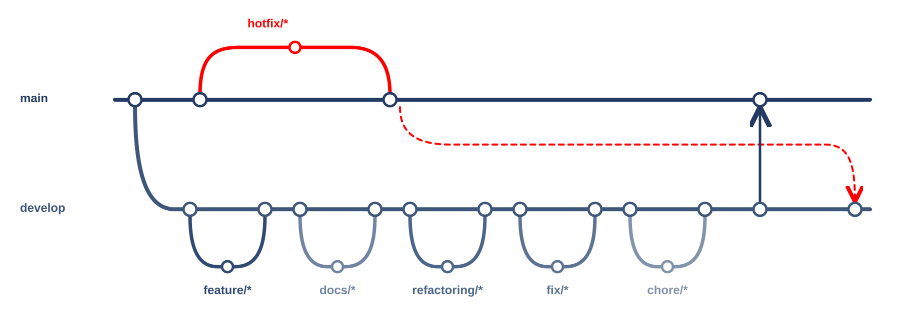

# 캠퍼스 3D 실험실

서경대학교 캠퍼스 3D 지도를 Android 에 맞게 다시 만드는 실험 저장소입니다.

## 개발 목적

수집·모델링 도구(캠퍼스 트래커)로 만든 캠퍼스 3D 모델을 휴대폰에서 빠르게 그릴 수 있는 형태(glTF)로 내보내고, 기기에서 직접 그리는 3D 부품을 만들어 실제 기기에서 성능을 잽니다.

## 사용 도구

| 구분 | 도구 |
|---|---|
| 모델 내보내기 | Node.js, CesiumJS 장면 캡처, glTF(GLB) |
| 기기 3D | Expo, expo-gl, three.js |
| 시험 앱 | Android(Java) WebView 시험 앱 |
| 측정 | adb, Chrome DevTools Protocol, 실제 갤럭시 S21 |

## 브랜치와 PR

- `main`: 배포용. 일반 변경은 PR로 병합.
- `develop`: 개발 통합용.
- `feature/*`, `docs/*`, `refactoring/*`, `fix/*`, `chore/*`: `develop`에서 분기 → 작업·검증 → PR → `develop` 병합.
- 배포 준비 완료 후 `develop` → `main` PR.
- `hotfix/*`: `main`에서 분기 → 검증 → PR 없이 `main` 병합·push. 같은 수정을 `develop`에도 반영.

PR은 목적·변경·확인·배포/후속을 각각 한 줄로 적습니다. 미검증은 이유를 적고, 배포 영향이나 후속 작업이 없으면 `없음`을 적습니다.

실행 방법과 개발 세부 내용은 [개발 가이드](docs/개발-가이드.md)에 있습니다.
